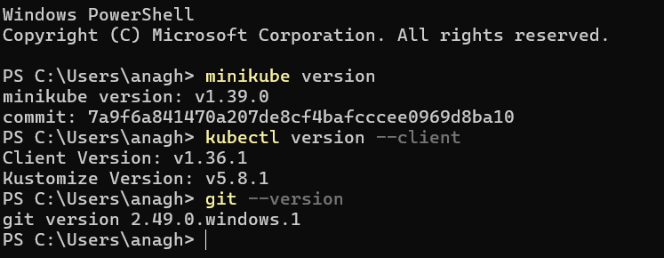
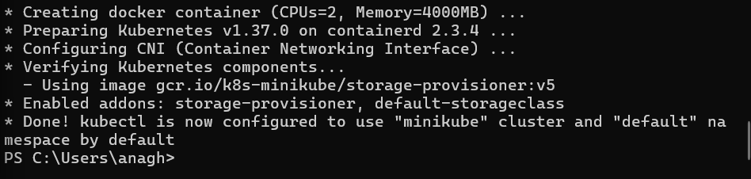
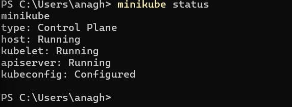
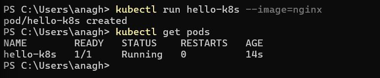
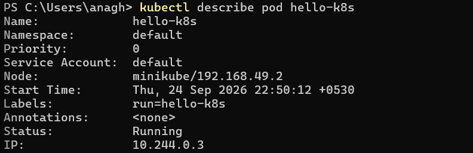
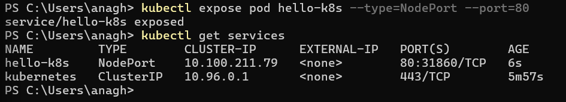
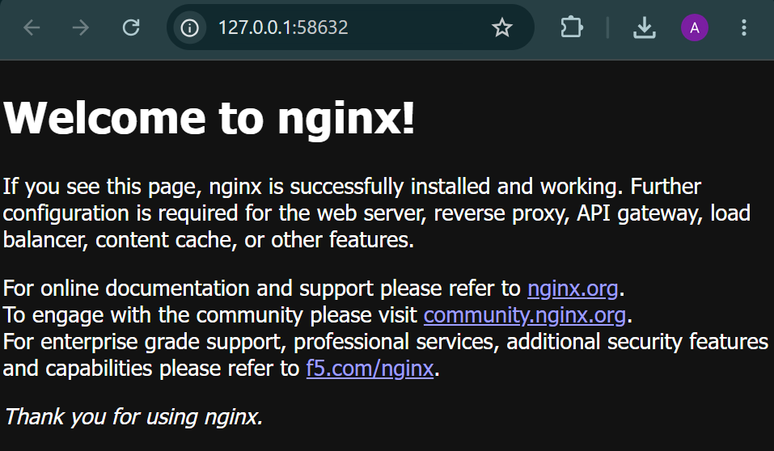
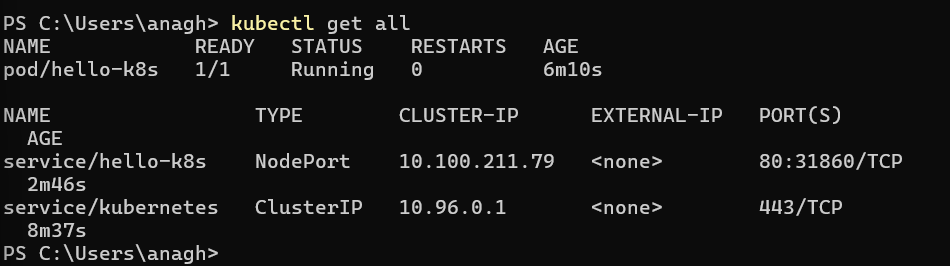

# Exercise 1 — Getting Started with Kubernetes

## Objective

The objective of this exercise is to get started with Kubernetes using Minikube and kubectl, deploy an Nginx application in a Kubernetes Pod, expose it using a NodePort Service, and access the application through a web browser.

---

## 1. Environment Verification

The following tools were used:

- Minikube
- kubectl
- Git
- Docker Desktop

### Versions

```powershell
minikube version
kubectl version --client
git --version
```



---

## 2. Starting Minikube

Initially, Minikube was configured to use the VirtualBox driver. However, the system was already using Windows virtualization through Hyper-V/VBS, which prevented VirtualBox from accessing VT-x/AMD-V.

Therefore, Docker Desktop was used as the Minikube driver.

### Command

```powershell
minikube start --driver=docker
```

Minikube successfully created a local Kubernetes cluster using Docker.



### What happened?

Minikube created a local Kubernetes cluster inside a Docker environment and configured kubectl to communicate with the newly created cluster.

The basic architecture is:

```text
Windows
   |
   v
Docker Desktop
   |
   v
Minikube
   |
   v
Kubernetes Cluster
```

---

## 3. Verifying the Kubernetes Cluster

### Command

```powershell
minikube status
```

The Kubernetes components were running successfully:

- Host — Running
- Kubelet — Running
- API Server — Running
- Kubeconfig — Configured



### Explanation

- **Host:** The Minikube environment is running.
- **Kubelet:** The Kubernetes agent responsible for managing containers on the node is running.
- **API Server:** The main interface through which kubectl communicates with Kubernetes is running.
- **Kubeconfig:** kubectl is configured to communicate with the Minikube cluster.

---

## 4. Creating an Nginx Pod

### Command

```powershell
kubectl run hello-k8s --image=nginx
```

The command created a Pod named `hello-k8s` using the Nginx container image.

### Verification

```powershell
kubectl get pods
```



The Pod reached the `Running` state:

```text
NAME        READY   STATUS    RESTARTS   AGE
hello-k8s   1/1     Running   0          ...
```

### Explanation

A **Pod** is the smallest deployable unit in Kubernetes. Kubernetes manages Pods rather than directly managing individual containers.

In this exercise:

```text
Pod: hello-k8s
       |
       v
Nginx Container
       |
       v
nginx Image
```

The `1/1` in the `READY` column means that one container was expected and one container was ready.

---

## 5. Inspecting the Pod

### Command

```powershell
kubectl describe pod hello-k8s
```



The Pod was successfully:

1. Scheduled to the Minikube node.
2. Assigned an IP address.
3. Loaded with the Nginx image.
4. Created as a container.
5. Started successfully.

The Kubernetes event sequence was:

```text
Scheduled
    ↓
Pulling
    ↓
Pulled
    ↓
Created
    ↓
Started
```

The Pod had the following state:

```text
Status: Running
Ready:  True
```

---

## 6. Exposing the Pod Using a NodePort Service

A Kubernetes Service provides a stable way to access an application running inside Pods.

### Command

```powershell
kubectl expose pod hello-k8s --type=NodePort --port=80
```

### Verification

```powershell
kubectl get services
```



The Service was created with:

```text
Type:      NodePort
Port:      80
NodePort:  31860
```

### Explanation

The Nginx application listens on port `80`.

Kubernetes assigned NodePort `31860`, allowing traffic to reach the Service through the Minikube node.

The resulting flow is:

```text
Client
  |
  v
NodePort :31860
  |
  v
Service :80
  |
  v
hello-k8s Pod
  |
  v
Nginx Container
```

A Service is useful because clients should not depend directly on a Pod IP. Pods can be replaced, while the Service provides a stable endpoint for accessing the application.

---

## 7. Accessing the Nginx Application

### Command

```powershell
minikube service hello-k8s
```

Minikube opened the Service in the default web browser.



The browser displayed the default Nginx welcome page, confirming that the application was successfully exposed and accessible.

Because the Docker driver was used on Windows, Minikube created a local tunnel to make the Kubernetes Service accessible from the host system.

---

## 8. Final Verification

### Command

```powershell
kubectl get all
```



The final Kubernetes resources included:

```text
Pod:
hello-k8s
Status: Running

Service:
hello-k8s
Type: NodePort
Port: 80
NodePort: 31860
```

This confirms that the Nginx Pod was running and the corresponding NodePort Service was successfully created.

---

## 9. Key Kubernetes Concepts Learned

### Minikube

Minikube provides a lightweight local Kubernetes cluster for learning and development.

### kubectl

kubectl is the command-line tool used to communicate with and manage Kubernetes clusters.

### Pod

A Pod is the smallest deployable unit in Kubernetes and can contain one or more containers.

### Container

A container is the running instance of a container image. In this exercise, the Nginx image was used.

### Node

A Node is a machine that runs Kubernetes workloads. In this exercise, Minikube provided the Kubernetes node.

### Service

A Service provides a stable way to access applications running inside Pods.

### NodePort

NodePort exposes a Service through a port on the Kubernetes node, allowing the application to be accessed from outside the cluster.

---

## Conclusion

In this exercise, a local Kubernetes cluster was created using Minikube with the Docker driver. An Nginx Pod was deployed and inspected using kubectl. The Pod was then exposed through a NodePort Service and successfully accessed through a web browser.

The exercise provided practical experience with Minikube, kubectl, Pods, containers, Services, and NodePort networking.
